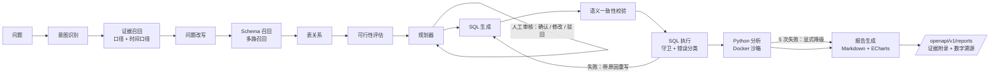

# GBI 企业问数复现

复现阿里云百炼析言 GBI 的企业问数链路：Schema 召回 → SQL 生成与守卫 → Python 分析 → Markdown 报告。场景是电商经营分析，加上库存、仓储、履约。

参考工程固定为 [spring-ai-alibaba/DataAgent @ b297203](https://github.com/spring-ai-alibaba/DataAgent/tree/b297203eecb2c2d6db45c2f5c0e15f1db4784d32)，不使用该提交之后的功能。从上游借用的是：工程结构、图的状态字段、节点连线和容器配置。下面这些都是自己做的：数据集和 schema、召回、SQL 守卫、人工审核的改造、沙箱修复、评测集和报告接口。

**面试准备**：讲稿（架构一页纸、逐条 bad case 与追问、缺口表）在 [docs/interview/](docs/interview/README.md)。简历每一条怎么做、为什么这么做、指标是多少，都整理在 [docs/resume-map.md](docs/resume-map.md)。每一步的设计说明在 [docs/design/](docs/design/)。

## 链路



| 环节 | 上游 b297203 | 本仓库 | 代码 |
|---|---|---|---|
| Schema 召回 | 不看问题文本，Recall@5 5.6% | 7 路召回：表向量、列向量、BM25、口径、枚举值、关联表、多轮；向量存 Milvus | `service/schema/recall/` |
| SQL 校验 | LLM 语义检查 | 加上 JSqlParser 守卫：语法、只读、表白名单、字段；错误分为选表 / 方言 / 执行三类，带原因重写 | `service/sql/guard/` |
| 时间口径 | LLM 自己推算日期（会写出 2 月 29 日） | 按日历算好半开区间注入证据；非法日期给出具体的修复提示 | `service/nl2sql/` |
| 人工审核 | 只有确认 / 驳回，驳回意见只保留最新一条，检查点存在内存 | 加上修改计划 JSON，驳回意见累积，重新规划最多 3 次，检查点可存 MySQL，重启后用 threadId 恢复 | `service/hitl/` |
| Python 沙箱 | CPU 实际能用 2 核，内存 1000 MiB（含 swap），进程数不限，池化容器会读到别的任务的输出 | 1 核、500 MiB、64 个进程、60 秒、无网络；输出隔离；失败 5 次后显式降级 | `service/code/` |
| 报告 | 只能在聊天页里看 SSE 流 | 开放接口、OpenAPI 文档、系统附上的证据附录、图表校验、失败原因、数字溯源、系统预先算好的合计 | `controller/ReportApiController.java`、`service/report/` |

## 快速开始

需要 Docker、JDK 17 + Maven、python3（带 `pyyaml`、`requests`），以及 `DASHSCOPE_API_KEY`。

```bash
export DASHSCOPE_API_KEY=...        # 阿里云百炼的 key
scripts/up.sh                       # 每一步都可重入；第一次运行要建库、向量化 86 张表（约 12 分钟）
```

`up.sh` 会依次起好：元数据库、示例数据源（MySQL :13306 / PostgreSQL）、Milvus、Python 沙箱镜像、`gbi_ecommerce` 数据集、后端 :8065、模型注册、“电商经营分析”智能体。如果 JVM 访问外网要走代理，设置 `MODEL_PROXY=host:port`。

生成一份报告：

```bash
curl -s localhost:8065/openapi/v1/reports -H 'Content-Type: application/json' \
  -d '{"agentId":"5","question":"2026年3月履约时效报告：整体准时送达率，以及各快递公司和仓库的表现"}' | jq '.status, .issues'
# 接口文档：http://localhost:8065/swagger-ui.html
```

`agentId` 用 `curl localhost:8065/api/agent/list` 查。

## 数据集

`dataset/` 下是 86 张表、1,146 个字段、312 条业务术语、126 个逻辑外键。数据覆盖 2024-11 到 2026-10，同时生成 MySQL 和 PostgreSQL 两份。

另有一个“注释消融”版本：38 张表去掉了注释。数据里埋了两个根因：

- 2026-10-12～18 华东区域仓数码类缺货。
- 2026 Q3 极速达发往西南的时效差。

数据里还特意留了陷阱：审计时间和业务时间、三级类目、汇总表粒度、店铺归属大区。说明见 [dataset/README.md](dataset/README.md)。

## 评测与结果

所有数字都是实测。简历里的百分比是目标，不是结果；没达到的地方都标出来了。

| 步骤 | 评测集 | 结果 | 详情 |
|---|---|---|---|
| 3 Schema 召回 | 180 道选表题，含 13 道多轮 | Recall@5：5.6%（上游）→ 69.8%（修复“不看问题”）→ 86.2%（全通道，全注释）/ 82.0%（注释消融）。Milvus 上复测 87.9% / 79.8%。目标是 93.3%，**未达到** | [step3](docs/design/step3-schema-recall.md)、[eval/table_select](eval/table_select/README.md) |
| 4 SQL 守卫 | 75 条正反例；14 种真实数据库报错 | 75/75 与标注一致（误拦 0/30），平均每条 3 ms；错误分类 14/14 | [step4](docs/design/step4-sql-guard.md)、[eval/sql_guard](eval/sql_guard/README.md) |
| 5 人工审核 | 9 个单测 + 真实后端端到端 | 确认、修改、驳回到上限三个场景都通过；MySQL 检查点下重启后能恢复执行（上游内存检查点做不到） | [step5](docs/design/step5-hitl.md) |
| 6 沙箱 | 9 个真实 Docker 用例 | CPU 1.99 → 1.00 核；内存 1000 → 500 MiB；进程数不限 → 64；跨任务输出泄漏 7/8 → 0/12 | [step6](docs/design/step6-sandbox.md) |
| 7 问数 | 320 题（dev 192 / holdout 128）；**实际跑了 40 题配对样本** | SQL 执行成功率 86.7% → 100%；首次即成功 76.7% → 90%；EX 50.0% → 56.7%；多步完成率 60% → 60%。holdout 目标 EX ≥ 85%，**差距大** | [step7](docs/design/step7-nl2sql-eval.md)、[eval/nl2sql](eval/nl2sql/README.md) |
| 8 报告 | 40 个任务；**实际跑了 8 题样本** | 完成 3/8；平均耗时 5.0 分钟，人工估算 64.3 分钟（人工是估算值）；“报告自己算错数”修复后 R07 由错变对 | [step8](docs/design/step8-reports.md)、[eval/report](eval/report/README.md) |

第 7、8 步只跑了样本，原因是 qwen3.8-flash 的免费额度用完了；之后的运行都换成了 qwen-plus。完整评测各需一条命令，都支持断点续跑：

```bash
python3 eval/scripts/run_table_select.py --agent 5 --tag full        # 第 3 步：180 题 Recall@5
(cd gbi-agent && mvn -Dtest='SqlGuardCasesTest,SqlErrorClassifierTest' test)   # 第 4 步
scripts/step7/run_eval.sh v2 dev && scripts/step7/run_eval.sh v2 holdout       # 第 7 步：320 题，holdout 只跑一次
python3 eval/scripts/run_reports.py --run full --all                 # 第 8 步：40 个报告任务
```

## 配置开关

所有改动都可以单独关掉，方便做前后对比：

| 配置 | 默认 | 作用 |
|---|---|---|
| `gbi.recall.enabled` | true | 多路召回；设为 false 回到上游的选表方式 |
| `gbi.recall.{vector,column,keyword,term,value,join,multi-turn}` | true | 逐个开关召回通道 |
| `gbi.nl2sql.time-hints` / `repair-hints` | true | 时间口径注入 / 非法日期的修复提示 |
| `gbi.hitl.max-replans` | 3 | 驳回后重新规划的上限 |
| `gbi.hitl.checkpoint` | memory | 设为 `mysql` 时，重启后能用 threadId 恢复 |
| `spring.ai.alibaba.data-agent.code-executor.*` | 1 CPU / 500 MiB / 60 s / 64 进程 / 无网络 | 沙箱限制 |
| `spring.profiles.active=milvus` | – | 向量存 Milvus；不启用时用内存向量库 |

## 仓库结构

```
gbi-agent/          后端（Spring Boot 3, Java 17），基于 b297203 的 data-agent-management
dataset/            schema、种子数据、术语表生成脚本，以及 M-Schema
eval/               table_select（180）/ sql_guard（75）/ nl2sql（320）/ report（40）及评测脚本
docs/design/        每一步的设计说明：问题、做法、为什么、备选方案、指标、面试问答
docs/api/           报告接口的 OpenAPI 文档
deploy/milvus/      Milvus standalone
sandbox/            Python 沙箱镜像
scripts/            up.sh、数据加载、智能体注册、各步骤的运行脚本
results/            各步骤的原始记录（日志不入库）
upstream/           b297203 快照，用于对比
```

## 没做和没验证的

- **Hologres / ADB-PG**：代码里支持它们的方言和错误码，但没有真实实例，只在 PostgreSQL 上验证过。
- **Turbo / Mix 模式和云上 + 本地混合部署**：没有实现。
- **XiYan-SQL 模型**：没有部署。SQL 生成用的是 Qwen（DashScope）；从 XiYan-SQL 借鉴的是 M-Schema 的格式和评测方法。
- **完整的 320 题和 40 个报告任务**：没有跑完，原因是额度。holdout 还没用过。
- **`up.sh`**：在已经部署好的环境上验证过可重入，但没有在全新机器上从零跑过。
