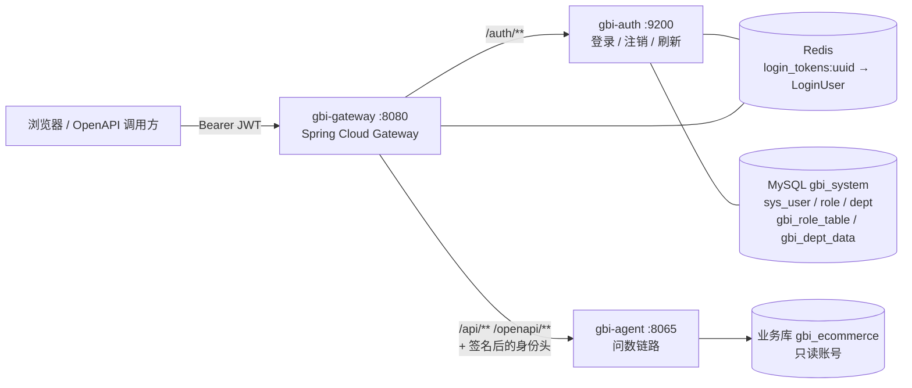

# 微服务网关、登录鉴权与数据权限（参考 RuoYi-Cloud / RuoYi-Cloud-Plus）

> 面向面试复盘：做了什么、为什么这么做、考虑过哪些方案、解决了什么问题、怎么量化。

## 1. 要解决的问题

上游 b297203 **完全没有鉴权**：没有 Spring Security，也没有 Sa-Token；`agent.api_key` 存了但从来不校验。只要能访问 :8065，就能：

- 读模型配置。`/api/model-config/list` 会返回 DashScope 的 API Key。
- 删除或修改智能体、数据源、提示词。
- 查任何表的任何数据。
- 知道别人的 threadId 后，替他审核计划，或者读他的报告（IDOR，越权访问对象）。

企业问数还多一层要求：**同一个问题，不同的人看到的数据不同**。比如华东运营只能看华东的店和仓，仓库主管只能看自己的仓，而且不能看交易和财务。难点在于 SQL 是大模型现写的。RuoYi 的做法是在 Mapper 方法上加 `@DataScope`、`@DataPermission` 注解，这里没有可以加注解的 Mapper 方法。

## 2. 整体结构



| 服务 | 对应 RuoYi-Cloud | 职责 | 代码 |
|---|---|---|---|
| gbi-gateway | ruoyi-gateway | 唯一入口；校验令牌；删除客户端伪造的身份头；给身份头签名；按用户限流 | `ruoyi/gbi-gateway` |
| gbi-auth | ruoyi-auth + ruoyi-system | 登录、注销、刷新；用户 / 角色 / 部门；登录时把数据范围解析成具体值 | `ruoyi/gbi-auth`、`ruoyi/sql/gbi_system.sql` |
| gbi-common-security | ruoyi-common-security | JWT、LoginUser、Redis key、签名算法 | `ruoyi/gbi-common-security` |
| gbi-agent | 业务服务 | 只认网关签名；功能权限；会话归属；表级和行级数据权限 | `gbi-agent/.../security/` |

一次请求的完整路径：

1. 登录：`POST /auth/login` → gbi-auth 校验 BCrypt 密码 → 读角色和部门，算出数据范围 → 把 LoginUser 写入 Redis（`login_tokens:{uuid}`，TTL 720 分钟）→ 返回 JWT。JWT 里只有 `user_key`、`user_id` 和 `username`。
2. 问数：`GET /api/stream/search` 带 `Authorization: Bearer …` → 网关依次做四件事：
   - 删掉请求里所有 `X-Gbi-*` 和 `from-source` 头
   - 验 JWT 签名
   - 查 Redis 里的会话是否还在
   - 把 LoginUser 放进 `X-Gbi-Login` 头，用 HMAC 签名后转发
3. gbi-agent 的 `GatewayAuthFilter` 依次检查签名、时间窗口（60 秒）和路径对应的功能权限，然后放进 `CurrentUser`。
4. `GraphServiceImpl` 先检查 threadId 的归属，再把数据权限写进图状态 `GBI_DATA_PERMISSION`。之后有两个节点用到它：
   - `SchemaRecallNode`：召回后去掉无权限的表
   - `SqlExecuteNode`：守卫通过后再查一次表权限，然后改写 SQL，加上行级过滤，再执行

## 3. 登录鉴权：为什么照搬 RuoYi 的“JWT + Redis 会话”

**做法**：JWT 不带过期时间，只是 Redis 会话的钥匙。会话的 TTL 就是有效期。注销时删掉 Redis key，令牌马上失效。

| 方案 | 没选的原因 |
|---|---|
| 纯无状态 JWT（带 exp，不存服务端） | 注销、踢人、改权限都要等令牌过期才生效，否则得维护黑名单，黑名单本身也是状态。问数权限变了必须马上生效。 |
| Spring Authorization Server / OAuth2 + Keycloak | 适合多应用单点登录，这里只有一个应用，部署和概念成本都高；面试也讲不出比 RuoYi 更多的东西 |
| Sa-Token（RuoYi-Cloud-Plus 用的） | 功能全，但令牌、会话、权限都封装在框架里。自己写一遍，能讲清每一步在做什么。如果是正式项目，我会直接用 Sa-Token |
| Spring Security 全家桶 | 网关是 WebFlux、业务服务是 Servlet，要配两套。这里鉴权逻辑很薄，一个过滤器就够 |

**密码和登录**：
- 密码用 BCrypt。
- 连续 5 次密码错误锁定 10 分钟（RuoYi `SysPasswordService` 的默认值），计数存在 Redis。
- “用户不存在”和“密码错误”返回同一句话，避免被用来探测有哪些用户名。
- 每次登录都写 `sys_logininfor` 登录日志。
- `/auth/refresh` 会重新读一次角色和授权，所以管理员改了权限，用户不用重新登录就能生效。

## 4. 网关：为什么要签名，为什么把 LoginUser 放在头里

**删除伪造头**：网关做的第一件事，就是删掉客户端带来的所有 `X-Gbi-*` 和 `from-source` 头，白名单路径也删。否则客户端自己加一个 `X-Gbi-User-Id: 1` 就冒充成管理员了。

**签名（这里比 RuoYi 多做的一步）**：
- RuoYi-Cloud 的下游服务信任网关转发来的头，前提是内网隔离：外部访问不到业务服务，再加上 `from-source: inner` 标记内部调用。
- 这里改成网关用 HMAC-SHA256 签名，签名内容是方法、路径、时间戳、user_key 和 LoginUser。gbi-agent 验签，时间窗口 60 秒。
- 这样即使内网有人直接调 :8065，或者身份头在别的环节被改，也会被拒绝。签名绑定了路径，拿一个查询请求的签名去调删除接口也不行。
- 代价是网关和 agent 共享一个密钥。更彻底的方案是 mTLS 或服务网格，不过要引入证书体系，对一个网关加一个服务来说太重了。

**LoginUser 放在请求头里，而不是让 agent 自己去 Redis 查**：
- RuoYi 的下游服务拿 `user_key` 自己去 Redis 取 LoginUser。
- 这里由网关取出来，签名后转发。好处是 gbi-agent 不用依赖 Redis，少一个故障点，签名也同时保护了权限内容。
- 两种做法对“权限变更多久生效”是一样的：LoginUser 都是登录或刷新时算好的。
- 头的大小：华东运营一共 8 个值，Base64 之后不到 1 KB。值多到上万个时，应该改回按 key 去取。

**限流**：`/api/stream/**` 和报告接口按用户限流，用 Redis 令牌桶，默认每秒 1 次、突发 5 次。问数一次要调用多次 LLM、跑几十秒，限流是为了控制成本，不是为了防 DDoS。

**没有用 Nacos / Sentinel**：
- 只有三个服务，路由写在配置里，地址用环境变量覆盖。
- 服务多了、需要多实例时，再接 Nacos 做注册发现：配置里的 `uri: http://…` 换成 `lb://gbi-agent` 就行，过滤器不用改。

**踩过的坑**：第一版的写法是 `redis.get(key).flatMap(v -> chain.filter(...)).switchIfEmpty(unauthorized)`。`chain.filter()` 在转发完成后返回的是一个空的 `Mono<Void>`，所以 `switchIfEmpty` 在**每个成功的请求**之后都会触发，去改一个已经提交的响应。结果是客户端偶尔报 “Response ended prematurely”。改法是先把 Redis 的查询结果包成 `Optional`，再分支。这是响应式编程里很典型的错误。

## 5. 功能权限

RuoYi 的权限字符串加上 `@RequiresPermissions`，在这里改成了配置（`application-security.yml`）：

| 路径 | 权限 |
|---|---|
| `GET /api/stream/**`、`/api/data-permission/**`、`GET /api/agent/list` | `gbi:query` |
| `/openapi/v1/reports`（POST、GET） | `gbi:report` |
| 其他（模型配置、数据源、智能体管理、提示词……） | `gbi:admin`（默认） |

- 没有匹配到任何规则的路径默认要求管理员权限（fail closed）。以后上游再加新接口，默认就是受保护的。
- 不在上游 Controller 上加注解，是为了少改上游代码，也方便跟另一条线的改动合并。代价是路径和权限的对应关系要靠配置维护。

## 6. 数据权限

### 6.1 RuoYi 的 data_scope 怎么用到业务数据上

RuoYi 的角色有 5 种数据范围：1 全部、2 自定义部门、3 本部门、4 本部门及以下、5 仅本人。它的 `DataScopeAspect` 在查询时把这些规则拼成针对 `sys_dept` 和 `create_by` 的 SQL 条件，前提是 RuoYi 自己的表都带 `dept_id` 和 `create_by`。

电商库里的业务表没有这两列，带的是 `shop_id` 和 `warehouse_id`。所以多加了一张 `gbi_dept_data`，把部门绑定到业务值上，比如“华东店群 → 店铺 1, 2, 3, 7, 10”，“上海前置仓 → 仓库 7”。登录时由 `DataScopeResolver` 按 RuoYi 的语义算出具体值：

| data_scope | 用哪些部门 | 例子（gbi_system.sql） |
|---|---|---|
| 1 全部 | 不过滤 | admin、finance |
| 2 自定义 | `sys_role_dept` | shop_ops → 华东店群 + 华北店群 |
| 3 本部门 | 用户所在部门 | sh_wh → 上海前置仓 → 仓库 7 |
| 4 本部门及以下 | 所在部门，加上 `ancestors` 里包含它的部门 | east_ops → 华东大区下的店群和三个仓 |
| 5 仅本人 | 业务表没有“属于谁”这一列，所以**解析成没有数据** | auditor |

多个角色之间取并集（OR），和 RuoYi 一致。

**为什么登录时就算好，而不是每次查询时再算**：
- 一次问数要执行好几条 SQL，每条都去查部门树没有必要。
- 算好的结果放在 LoginUser 里，也方便审计，日志里能直接看到“这个人这次查询能看到哪些值”。
- 代价是改了权限要刷新或重新登录才生效。

### 6.2 表级：两处都要拦

授权粒度是角色可以查哪些表，比如 `wms_*`、`dim_*`，`*` 表示全部（`gbi_role_table`）。检查放在两个地方：

1. **召回之后去掉无权限的表**（`SchemaRecallNode`）：模型看不到这些表的结构，不会泄露表结构，也不会白白生成一条注定被拦的 SQL。
2. **执行前再查一次**（`SqlExecuteNode`，用的是守卫解析出来的全部表）：这一步不能省。端到端实测，仓库主管问“各店铺 GMV”，召回之后只剩 `dim_shop`，但模型还是从业务口径（证据）里学到了 `trd_daily_shop_sales`，写进了 SQL，被这一步拦了下来。

被拦之后，权限错误会回给模型重写一次，因为它也许能换一张有权限的表来回答。**连续两次被拦就停止**，告诉用户“这个问题超出你的数据权限”。原来会重写满 10 次。实测这个问题从 86.8 秒、10 次 SQL 生成，降到 54.3 秒、2 次。

### 6.3 行级：参考 RuoYi-Cloud-Plus，但条件加的位置不同

**策略从哪来**：`data-permission/row-policies.yml` 由 `scripts/security/gen_row_policies.py` 根据数据集的元数据生成，86 张表里有 50 张受控：
- 直接带 `warehouse_id` 或 `shop_id` 的表，按这一列过滤。
- 子表沿逻辑外键找到父表，用 IN 子查询过滤，比如 `trd_refund_item → trd_refund → trd_order.shop_id`，最多三层。
- 剩下的是共享的参考数据（类目、会员、地区、日期），不过滤。
- `wms_transfer` 有调出仓和调入仓两列，手写一条覆盖：任意一边是自己的仓就能看到。

RuoYi-Plus 把这些声明写在 Mapper 的注解上，这里没有 Mapper，所以声明从代码挪到了表上。

**怎么加条件**（`RowPermissionRewriter`）：
- 用 JSqlParser 解析，遍历方式和 SqlGuard 一样（`TablesNamesFinder`），所以守卫看得到的每一张表，这里都会改写。
- 每一处读受控表的地方，原地替换成派生表：

```sql
-- 模型写的
SELECT s.name, SUM(o.pay_amount) FROM trd_order o JOIN dim_shop s ON s.id = o.shop_id GROUP BY s.name
-- 实际执行的（华东运营）
SELECT s.name, SUM(o.pay_amount) FROM (SELECT * FROM trd_order WHERE shop_id IN (1, 10, 2, 3, 7)) o
  JOIN dim_shop s ON s.id = o.shop_id GROUP BY s.name
```

| 方案 | 没选的原因 |
|---|---|
| RuoYi-Plus 的做法：往每个 SELECT 的 WHERE（以及 JOIN 的 ON）后面追加 `AND 条件` | 条件要用模型起的别名重新限定；条件放进 LEFT JOIN 查询的 WHERE，会把外连接变成内连接；子查询、CTE、UNION 里的每一层都要单独处理。RuoYi-Plus 处理的是人写的 Mapper SQL，形状可控；大模型写的 SQL 不可控 |
| 数据库原生行级安全（PostgreSQL RLS） | MySQL 没有这个功能；Hologres / ADB-PG 的支持程度也不一样。要让它生效，每个用户得有自己的数据库角色或会话变量，连接池就没法共享了 |
| 每个角色建一套视图 | 视图数量是角色数 × 表数；权限一变就要改 DDL；还得按用户切换 schema |
| 查完以后在内存里过滤 | 聚合已经算完了，SUM 和 COUNT 里已经包含了无权限的行，过滤不掉 |
| 让模型自己加条件（写进提示词） | 不可靠，只要被提示注入一次就绕过去了；这类控制必须是确定性的 |

派生表方案的好处：
- 条件写在裸表上，跟外层用什么别名无关。
- 外层查询的连接方式和 NULL 语义都不变。
- MySQL 8 和 PostgreSQL 都会把这种派生表合并回原来的执行计划。

**fail closed（拿不准就拒绝）**：
- 解析失败，拒绝。
- 遍历时找到了受控表却没能替换（出现在没处理到的语法位置），拒绝。
- 用户在某个维度上没有值，条件写成 `1 = 0`。
- 数值维度的取值必须是整数，否则直接丢掉，所以即使 LoginUser 被伪造了，也注入不了 SQL。

**模型看到的仍是原 SQL**：
- 状态里存的、重写时参考的、下一轮对话的上下文里带的，都是模型自己写的 SQL。
- 原因是如果模型看到了过滤条件，它可能照抄，下次又多套一层。
- 实际执行的 SQL 写进日志（`data_permission exec user= scope= filtered= sql=`），页面上提示“已按数据权限过滤：表名”。

### 6.4 会话归属（threadId）

- `gbi_thread_owner` 表记录每个 threadId 是谁创建的。新问题会认领这个 threadId，或者校验它已经属于自己；恢复审核和读报告时都必须是本人。
- 这个检查要放在 StreamContext 之前。上游的 `streamContextMap.computeIfAbsent(threadId).setSink(sink)`，会让后来的请求把自己的 SSE 输出接到别人的会话上。
- 表放在元数据库里，和 MySQL 检查点放在一起，所以重启后照样能校验。

## 7. 量化

评测都经过网关，完整链路是：登录 → JWT → 网关签名 → agent → 守卫 → 改写 → MySQL 只读账号。命令：

```bash
python3 eval/data_permission/run_permission_eval.py --agent 5      # 1,684 例，约 6 分钟，不调用 LLM
python3 eval/data_permission/bench_gateway.py                      # 网关延迟
python3 eval/data_permission/run_e2e_llm.py --agent 5              # 真实模型，6 个问题
```

### 7.1 行级改写是否正确：和“物理隔离的副本”逐条对比

做法：
- 用评测集里全部 276 条标准 SQL（320 题里有 44 道多步题没有单条 SQL），分别以 6 个用户的身份执行，共 1,656 例。
- 每个用户建一个 `gbi_scope_<user>` 库：受控表是带过滤条件的视图，其他表直接映射到原表。
- 标准 SQL 在这个库里跑出的结果作为正确答案。这条路径用的是 MySQL 视图，没有经过 JSqlParser 改写，所以能独立地检验改写对不对。

| 指标 | 结果 |
|---|---|
| 涉及未授权表，应当拦截 | **380 / 380 拦截** |
| 可以执行的查询，结果和物理隔离副本一致 | **1,276 / 1,276** |
| 其中实际加了行过滤的 | 768 |
| 其中过滤后结果确实和全量不同 | 711（说明比对不是空对空） |
| 误拦（有权限的查询被拒） | **0** |
| 第一次跑出来的不一致 | 72 条，全部是比较脚本的问题：agent 把 NULL 输出成空串，mysql 命令行输出的是 `NULL`。修了比较脚本，没有改产品代码 |

### 7.2 越权攻击：28 条手写攻击

| 类别 | 例子 | 结果 |
|---|---|---|
| 用未授权的表（12 条） | 直接查、子查询、CTE、UNION、EXISTS、标量子查询、库名限定、反引号加大小写、LATERAL、JOIN、系统库、多语句 | 12 / 12 拦截 |
| 绕过行级过滤（16 条） | `WHERE shop_id = 4`、`OR 1 = 1`、查子表、两跳和三跳子表、共享维表 LEFT JOIN、别名伪装成维表、派生表、注释、自连接、括号 JOIN、HAVING 子查询、调拨双向、没有该维度、仅本人 | 16 / 16 没有泄露：15 条结果和隔离副本一致；`OR 1 = 1` 被数据源层的 Druid WallFilter 直接拦下（又多一层防线） |

### 7.3 接口层：11 项

全部通过：
- 没有令牌、令牌是乱写的、篡改了载荷（user_id 2 改成 1）：401
- 通过网关伪造 `X-Gbi-Login`、`X-Gbi-User-Id`、`from-source`：被删掉，身份仍是本人
- 绕过网关直接调 agent，带伪造头或者什么头都不带：401
- 没有报告权限却调报告接口、非管理员删智能体、非管理员读模型配置：403
- 注销后用旧令牌：401
- 读别人的报告：403

另外，gbi-auth 实测：连续 5 次密码错误后返回 423，锁定 10 分钟。

### 7.4 真实大模型端到端（qwen-plus，同一个问题换不同用户）

| 用户 | 问题 | 结果 |
|---|---|---|
| admin | 2026 年 3 月各店铺 GMV | 12 家店 |
| east_ops（华东大区） | 同上 | 5 家店（1、2、3、7、10），提示“已按数据权限过滤：trd_daily_shop_sales” |
| shop_ops（华东 + 华北店群） | 同上 | 7 家店 |
| sh_wh（上海前置仓，没有交易表权限） | 同上 | 召回后只剩 `dim_shop`，但模型仍写了 `trd_daily_shop_sales`，被权限拦下；连续两次后停止并说明原因，54.3 秒 |
| sh_wh | 3 月各仓库出库单数 | 只有上海前置仓：44 |
| east_ops | 同上 | 华东三个仓：412、55、44 |
| east_ops 接管 sh_wh 的 threadId（恢复审核 / 追问） | | 都返回 403 |

各店铺的数字和 admin 结果里对应店铺的数字完全一样。也就是说，过滤只是去掉了行，没有改变每一行的值。

### 7.5 性能开销

| 项 | 结果 | 说明 |
|---|---|---|
| 网关带来的延迟（单客户端，2,000 次） | P50 **+0.98 ms**，P99 **+3.75 ms** | 比较的是同一个接口：经网关（验 JWT + 查 Redis + 签名 + 多一跳）和直接调 agent（带合法签名） |
| agent 验签和权限检查 | P50 约 +0.01 ms | 直接调 agent 时，带签名的受保护接口和不需要鉴权的接口几乎一样快 |
| 行级改写 | 每条约 1.7 ms | 276 条标准 SQL 跑 20 轮的平均值 |
| 对比 | 一次问数 77–98 秒 | 安全层的开销可以忽略 |

16 并发时，Python 客户端自己成了瓶颈（GIL），三条路径的 P99 都在 40 ms 左右，看不出差别。所以只引用单客户端的数字。

## 8. 没做的，以及要收着讲的

- **评测只在 MySQL 上跑过**。改写生成的是标准 SQL（派生表 + IN），PostgreSQL / Hologres 上没有实际跑过。
- **用于对比的物理隔离副本，用的是同一份策略文件**。它检验的是“改写是否正确地套用了策略”，不检验“策略本身定义得对不对”。策略对不对，靠的是生成脚本：根据外键生成，人工看过 50 条。
- **召回阶段的枚举值和列样本可能露出无权限的值**，比如别的店铺的名字。店铺和仓库是共享维表，所以这里接受；如果维表也要隔离，需要把它们加进策略。
- **业务口径（证据）里会出现表名**。模型因此会写出没有权限的表（见 7.4）。现在靠执行前的检查拦下，还没有在证据召回阶段按权限过滤。
- **没做列级脱敏**，比如手机号打码。思路是在同一棵语法树上把 SELECT 里的敏感列包一层函数，或者在结果集上打码。
- **聊天会话相关接口**（`/api/sessions` 等）上游没有按用户隔离，这里先只给管理员开放，没有做按用户过滤。
- 单个网关实例，没有接 Nacos、Sentinel；密钥通过环境变量传入；没有刷新令牌轮换。
- `SECURITY=on` 是可选的。默认的单进程模式和之前的评测脚本不受影响。

## 9. 面试问答

- **为什么网关已经鉴权了，agent 还要验签？** 网关鉴权只能证明“请求是从网关来的时候合法”。agent 要能拒绝不是从网关来的请求，否则身份头可以伪造。RuoYi 靠内网隔离来保证这一点，这里改成用签名证明，不依赖网络拓扑。
- **JWT 为什么不带过期时间？** 过期由 Redis 会话的 TTL 控制，注销和改权限都能马上生效。JWT 只是钥匙，不承载权限。
- **行级权限为什么不让数据库来做？** MySQL 没有 RLS。PostgreSQL 的 RLS 要求每个用户用自己的会话身份连接，连接池就没法共享了。三种数据源统一在应用层，用同一棵语法树来做，最简单。
- **为什么不往 WHERE 里加条件？** 两个原因。一是 LEFT JOIN：把右表的条件放进 WHERE，外连接就变成了内连接。二是别名：模型会给表起各种别名，条件要跟着重新限定。派生表把条件封在裸表上，跟外层怎么写无关。
- **怎么证明改写没有漏掉？** 两点。第一，改写和守卫用的是同一个遍历器，找到了受控表却没能替换就直接拒绝。第二，1,276 条标准 SQL 的结果都和物理隔离的副本一致，其中 711 条的结果确实被过滤改变了。
- **子表没有 shop_id 怎么办？** 沿逻辑外键用 IN 子查询找到父表，最多三层（比如 `tms_shipment_track`）。这些策略由脚本根据元数据生成，不是一张张手写的。
- **为什么表级要在召回和执行前拦两次？** 召回时拦，是为了不把表结构给模型看，也省得白白生成一次 SQL；执行前拦，是因为模型会从证据里“想起”没召回的表，实测就发生过。
- **用户没权限时，系统怎么表现？** 给一次重写的机会，因为模型也许能换一张有权限的表；第二次还被拦就停下来，明确告诉用户“超出你的数据权限”，不再重试满 10 次。
- **RuoYi 的“仅本人”在这里怎么处理？** 业务表没有“属于谁”的列，所以解析成没有数据，宁可查不到，也不能多给。
- **网关开销是多少？** P50 不到 1 ms，P99 不到 4 ms。一次问数要几十秒，可以忽略。
