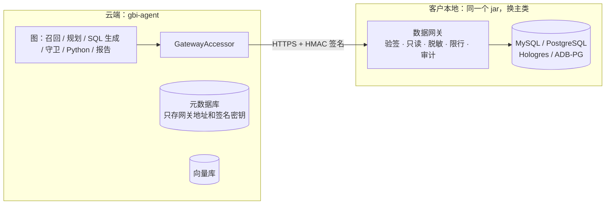

# 第 10 步：Turbo / Mix 两种模式，云上 + 本地混合部署

## 1. 解决什么问题

简历里写了“支持 Turbo / Mix 两类版本及公共云 / 本地混合部署”，第 9 步时这两项都没有实现。这一步先对照析言 GBI 的官方文档弄清它们到底指什么，再在当前 master 上实现，并给出可以复现的对比数字。

**官方文档怎么说**（[产品简介](https://help.aliyun.com/zh/model-studio/brief-introduction-of-gbi-products)、[本地数据最佳实践](https://help.aliyun.com/zh/model-studio/xiyan-gbi-local-data-best-practices)）：

| 版本 | 原文 | 结果干预的方式 | 部署 |
|---|---|---|---|
| 标准版 Turbo | “响应迅速，适合开箱即用的通用查询，允许通过规则干预输出” | **规则**：问法描述 + 对应 SQL | 公共云，不支持微调 |
| 标准版 Mix | “支持业务定制和结果干预，精度更高，允许通过案例学习提升处理能力” | **案例**：添加问答案例让模型学习，泛化性更强 | 公共云，不支持微调 |
| 定制版 Turbo | “支持公共云、公共云与本地混合部署（服务在云、数据在地），支持模型微调” | – | 公共云，或混合部署 |

本地数据的调用流程是：云端 `RunSqlGeneration` 生成 SQL → 客户在本地执行 → 把结果交给云端 `RunDataResultAnalysis` 做分析。也就是说，GBI 的“数据在地”指**库和账号在本地，SQL 在本地执行**；查询结果仍然会回到云端，由模型分析。

所以这里有两个独立的维度：

1. **模式**（Turbo / Mix）：速度、精度、成本之间的取舍，以及业务方用什么方式干预结果（规则还是案例）。
2. **部署**（公共云 / 混合）：数据库连接信息和执行放在哪里。

文档没有公开 Turbo 和 Mix 各用什么模型、链路有什么差别。下面的映射是我的解读，面试时要说清楚“这是复现，不是 GBI 的内部实现”。

## 2. 怎么做的

### 2.1 模式：一组按请求生效的配置

`gbi.mode.profiles.*`（`service/mode/GbiModeProperties.java`），请求里带 `mode=turbo|mix|default`，接口 `/api/stream/search` 和 `/openapi/v1/reports` 都支持。

| 字段 | default（上游行为） | turbo | mix |
|---|---|---|---|
| 模型 | 智能体当前激活的模型（qwen-plus） | qwen3.7-flash，关闭思考 | qwen-plus |
| 可行性评估（1 次 LLM） | 开 | **跳过** | 开 |
| 语义一致性校验（每条 SQL 1 次 LLM） | 开 | **跳过**，靠第 4 步的 JSqlParser 守卫兜底 | 开 |
| SQL 重试上限 | 10 | 3 | 10 |
| 规则干预 | 关 | 开 | 开 |
| 案例学习 | 关 | 关 | 开，取最相似的 3 个 |

`GET /openapi/v1/modes` 列出所有模式，`GET /openapi/v1/usage` 按模型返回调用次数和 token 数。

**模型是怎么按请求切换的。** 上游的 `LlmService` 只认智能体激活的那一个模型。改法：

1. 请求进来时，`GraphServiceImpl` 把模式名写进图状态（`GBI_MODE`），未知模式直接报错，不会悄悄退回默认。
2. `aop/GbiModeAspect` 包住每个节点的 `apply()`，把这次请求的模型放进 `ModeContext`（ThreadLocal），节点结束后恢复。
3. `StreamLlmService` / `BlockLlmService` 每次调用时读 `ModeContext`，用 `OpenAiChatOptions.model(...)` 覆盖模型，并打开 `streamUsage` 拿到 token 数，记进 `LlmUsageMeter`。

为什么不按智能体配置（GBI 是按版本开通的）：对比实验需要同一个智能体、同一份向量、同一道题，只换模式。按请求切换是按智能体配置的超集，`gbi.mode.default-mode` 就是智能体级的默认值。

**踩过的两个坑：**

- **思考没关掉。** qwen3.7-flash 默认开思考，要在请求体里带 `enable_thinking: false`。Spring AI 1.1.0 合并调用选项时会丢掉 `extraBody`，所以这个参数根本没发出去。第一次冒烟测试 Turbo 一题用了 18k 个输出 token、108 秒，比 Mix 还慢。修法：用一个请求头把开关带到 `DashScopeOpenAiApi`（`OpenAiApi` 的子类），由它写进请求体，再把头去掉。`ModeOptionsWireTest` 起一个本地 HTTP 服务，断言请求体里确实有 `"model":"qwen3.7-flash"` 和 `"enable_thinking":false`。修好后同一题 19.7 秒、634 个输出 token。
- **换了线程，模式就丢了。** `SqlExecuteNode` 在另一个线程里调用 LLM 生成图表配置，ThreadLocal 是空的，于是退回了默认模型。修法：进入 `Flux.create` 之前先取出模式，在新线程里重新设置。`LlmUsageMeter` 在 DEBUG 级别会记下每次调用来自哪个类，就是靠它发现的。

### 2.2 规则干预和案例学习

- **规则**（`resources/gbi/rules.yaml`，6 条）：关键词触发，命中就把“必须遵守”的 SQL 写法放进证据。例如问题里有“一级类目”，就要求订单明细的三级类目沿 `prd_category.parent_id` 向上关联两次，再用一级类目名过滤；有“华东”这类大区名，就规定默认按店铺归属大区（`dim_shop → dim_region`），只有“发往 / 收货”才按收货地址；有“月 / 季度”，就提醒 `created_time` 是审计时间，订单要用 `paid_at`。这些都来自第 7 步失败分析里反复出现的口径错误。GBI 的规则是“问法描述 + 对应 SQL”，形式相同。
- **案例**（`gbi.mode.cases-file`，评测用 `eval/mode/cases.jsonl`，17 条）：问题和正确 SQL 成对。用字符二元组 TF-IDF 余弦取最相似的 3 条，放进证据，标题是“相似问题的正确 SQL”。
- 两者都在 `EvidenceRecallNode` 里加到证据末尾，后面的规划器和 SQL 生成器都能看到。

为什么案例检索用 TF-IDF 而不是向量：只有 17 条，TF-IDF 没有额外依赖、不增加延迟、结果确定，便于复现。案例多了以后应该放进现有的 Milvus。

**防止评测泄漏**：dev 集按“题族”（同一个模板生成的题）组织。案例取自第 7 步样本用过的 17 个题族，评测题取自从未用过的 28 个题族，两者没有同族题。holdout 没有动。

### 2.3 混合部署：服务在云，数据在地

**切分点选在 `Accessor` 接口。** DataAgent 里所有取数（列表、列信息、外键、采样、执行 SQL）都经过这个接口，一共 9 个方法。新增数据源类型 `mysql-gateway` / `postgresql-gateway`，对应的 `GatewayAccessor` 不连数据库，而是把方法名和参数签名后发给网关。网关用原来的 JDBC 实现执行，再把结果原样返回。接口以上的召回、守卫、执行、错误分类、Python、报告**一行都没改**。

**网关**（`com.alibaba.cloud.ai.gbigateway`，启动：`scripts/gateway.sh`）是同一个 jar 换一个主类，上下文里只有 Web 服务和 JDBC 连接器，不连元数据库，不调模型，不碰向量库，1.5 秒启动。不管云端发来什么，它都强制执行这几条：

| 控制 | 做法 | 为什么在网关再做一遍 |
|---|---|---|
| 身份 | `X-Gbi-Signature: t=时间戳,n=随机数,sig=HMAC-SHA256(密钥, t.n.body)`；时间偏差超过 300 秒拒绝；同一个随机数在窗口内出现两次拒绝（防重放） | 网关端口对云端开放，要证明请求来自云端、内容没被改 |
| 只读 | 只允许 9 个读方法；SQL 必须被 JSqlParser 解析成**恰好一条** SELECT，解析失败也拒绝；另外拒绝 `INTO OUTFILE` 和 `FOR UPDATE` | 云端已经有第 4 步的守卫。但在混合部署里，客户不应该信任云端，库边上要有自己的一道 |
| 范围 | 使用网关自己配置的 schema，忽略请求里的 | 云端不能让网关去读别的库 |
| 外发量 | 每次最多返回 1000 行 | 限制一次能带走多少数据 |
| 个人信息 | 列名匹配手机号、收件人、证件号、邮箱、详细地址的，值在离开网关前打码（`138****5678`、`张**`） | 业务分析用不到这些值；列样本也会进向量库，必须在源头打码 |
| 审计 | 每个请求一行 JSON：方法、SQL、行数、字节数、打码的格子数、耗时、错误 | 客户能查到哪些数据离开过 |
| 错误 | 数据库报错时返回 SQLState 和厂商错误码，云端重建成 `SQLException` | 第 4 步“选表 / 方言 / 执行”的错误分类和带原因重写照常工作 |

**云端存了什么。** 数据源记录里只有网关地址（host / port / connection_url）和签名密钥（存在 password 字段）。数据库的地址、账号、密码只在网关的配置文件里。

### 2.4 为什么这样切（考虑过的方案）

| 方案 | 问题 |
|---|---|
| VPN / 专线，让云端直连数据库 | 最简单，但数据库账号密码要存在云端，数据库端口要对云开放。“数据不出域”的客户通常不接受 |
| 在网关做数据库协议代理（MySQL / PG 协议） | 要实现协议细节，审计和打码只能在字节流上做，很难做对 |
| 模型也部署到本地 | 那是私有化部署，要 GPU，不是“服务在云” |
| **在 `Accessor` 接口处切开（采用）** | 接口窄（9 个方法），上层零改动；审计、打码、只读都在结构化的数据上做；新数据源方言由网关里现成的 JDBC 实现负责 |

## 3. 数字

### 3.1 Turbo / Mix / default 配对对比

23 道 dev 题（来自第 7 步从未用过的 28 个题族；案例库取自其他题族；holdout 没动），同一后端逐题配对，用量来自后端的计量。详见 [eval/mode/README.md](../../eval/mode/README.md)。

| 模式 | EX | 耗时 p50 | LLM 调用 / 题 | token / 题 | 成本 元 / 题 |
|---|---|---|---|---|---|
| default（上游，qwen-plus） | 13/23 = 56.5% | 35.1 s | 10.5 | 59.9k | 0.0512 |
| turbo 去规则（只换小模型 + 精简链路） | 14/23 = 60.9% | 14.6 s | 7.3 | 38.2k | 0.0081 |
| **turbo** | **17/23 = 73.9%** | **13.9 s** | 7.4 | 40.7k | **0.0087** |
| mix 去案例（qwen-plus + 规则） | 17/23 = 73.9% | 35.2 s | 9.8 | 59.3k | 0.0502 |
| **mix** | **21/23 = 91.3%** | 36.9 s | 10.7 | 72.3k | 0.0611 |

- **Turbo 对比 default**：耗时 35.1 → 13.9 s（快 2.5 倍），成本 0.051 → 0.0087 元 / 题（降 83%），EX 56.5% → 73.9%。消融显示，只换小模型、精简链路时 EX 持平（14 vs 13）；多出来的 3 题来自规则。
- **Mix 对比 default**：EX 56.5% → 91.3%，逐题 8 胜 0 负（符号检验 p = 0.008，是唯一显著的差别）；成本 +19%，耗时基本不变。规则和案例各贡献约 4 题。
- **噪声有多大**：同一个 Turbo 配置跑两次（直连一次、混合部署一次），EX 都是 17/23，但有 6 题一次对一次错。所以 23 题上 ±3 题以内的差别不能算数，Turbo 的提升（6 胜 2 负，p = 0.29）只能说“方向一致”。

### 3.2 混合部署

**结果一致性和延迟**（`GatewayBenchmark`，320 题里全部 276 条标准 SQL，每条先直连再走网关，两边用同一套 JDBC 实现）：

| 指标 | 直连 | 经网关 |
|---|---|---|
| 结果与直连完全一致（列名 + 每一行） | – | **276 / 276** |
| 每条 SQL 耗时 p50 / p90 | 10.2 / 21.2 ms | 14.8 / 25.7 ms |
| 网关带来的额外耗时 p50 / p90 | – | **4.5 / 8.2 ms** |
| 每条 SQL 平均返回 | – | 313 字节（平均 6 行） |

网关和后端在同一台机器上，测的是签名、HTTP、JSON 和打码的开销。真实部署要再加上一次公网往返（几十毫秒）。一道题一般执行 1～3 条 SQL，而 LLM 部分要 13～36 秒，所以网关的开销可以忽略。

**经网关初始化 schema**（新建 `mysql-gateway` 数据源和智能体，86 张表全部经网关取元数据并向量化）：

| 方法 | 次数 | 离开网关的字节 | 打码的格子 |
|---|---|---|---|
| 表列表 | 1 | 12.6 KB | 0 |
| 列信息 | 86 | 156 KB | 0 |
| 每表 5 行样本 | 86 | 147 KB | **25**（会员手机号、供应商电话、收件人姓名、电话、详细地址各 5 个） |

样本 SQL 有 1 条失败：`dim_date` 的列名 `year_month` 是 MySQL 关键字，上游拼样本 SQL 时没加反引号。直连时同样失败，和网关无关。

**端到端**：在混合部署的智能体上用 Turbo 跑同样的 23 题，所有 SQL 都经网关。EX 17/23（直连 Turbo 也是 17/23），执行成功 23/23，耗时 p50 14.1 s（直连 13.9 s）。23 题一共执行 29 条 SQL，离开网关 31.8 KB，平均每题 1.4 KB。第一题时，召回的“枚举值”通道经网关建索引（229 条 `SELECT DISTINCT`，58 KB），收件人姓名的 18 个值被打码，所以枚举索引里没有真实姓名。

**安全测试**（`GatewayRoundTripIT`、`GatewayPostgresIT`、`GatewayUnitTest`，共 7 个用例，全部通过）：

- 写操作（`DELETE`）、多语句（`SELECT 1; DROP TABLE t`）、`INSERT ... SELECT`、`INTO OUTFILE`、`FOR UPDATE`、`CALL`、无法解析的 SQL：全部 403。
- 错误密钥、篡改请求体、篡改随机数、超出时间窗口：全部 401。同一个请求原样重放：401 `replayed request`。
- 不存在的列：MySQL 返回 42S22，PostgreSQL 返回 42703，云端都能归到“选表”类错误。
- 收件人姓名在 MySQL 和 PostgreSQL 上都打了码；200 行的查询只返回 50 行（测试里上限设成 50）。

**元数据库核对**：`mysql-gateway` 数据源那一行，host / port 是网关地址，username 是占位的 `gateway`，password 是网关签名密钥，**不含数据库密码**。

**一个修过的问题**：最初用签名本身做重放检测。跑基准时，同一秒内两次发送同一条 SQL 签名完全相同，第二次被误判为重放，276 条里有 18 条失败。改成签名里带随机数、用随机数去重之后，276 条全部通过。

## 4. 局限

- **Hologres / ADB-PG 仍然没有在真实实例上验证。** 网关走 PostgreSQL 方言，已在本地 PostgreSQL 上跑通。需要 caitlin 提供的东西见第 6 节。
- **网关要开放入站端口。** 生产上更好的做法是网关主动连云端（长连接，反向通道），客户防火墙只需要放行出站。这里为了简单用的是入站 HTTP。
- **本地测试用的是 HTTP。** 生产必须是 HTTPS，最好双向 TLS；签名只保证身份和完整性，不加密。
- **数据并不是完全不出域。** 和 GBI 一样，表结构、5 行样本（已打码）和查询结果都会到云端给模型用。网关能控制的是：出去多少、哪些列打码、有没有记录。
- 密钥轮换没做：目前改密钥要同时改网关配置和数据源记录。
- 模式对比只有 23 题，结论是方向性的。

## 5. 面试问答

**问：Turbo 和 Mix 到底差在哪？**
官方只说 Turbo“响应迅速、通用查询、用规则干预”，Mix“精度更高、用案例学习”。我的复现里，Turbo 用小模型、关思考、去掉两次 LLM 校验，靠确定性的 JSqlParser 守卫兜底；Mix 用大模型、完整校验，加上案例。数字上，Turbo 比上游快 2.5 倍、便宜 83%，EX 56.5% → 73.9%；Mix EX 91.3%，成本只多 19%。

**问：Turbo 的提升是模型带来的还是规则带来的？**
做了消融。只换小模型、去掉两次 LLM 校验，EX 和上游持平（14 vs 13）；加上规则到 17。所以小模型 + 精简链路换来的是速度和成本，准确率靠规则补。Mix 也一样拆过：规则 +4、案例再 +4。

**问：23 题能说明什么？**
能说明方向，不能当精确比率。我专门量了噪声：同一配置跑两次，EX 一样，但有 6 题结果互换。所以我只把 Mix 的 8 胜 0 负（p = 0.008）当成显著结论，其余写成“方向一致”。

**问：为什么 Turbo 去掉语义校验还敢上？**
第 4 步的守卫已经在 SQL 执行前查语法、只读、表白名单和字段，这些是确定性的，几毫秒。语义校验是 LLM 判断“SQL 是否符合计划”，第 8 步里它还出现过“按错误的计划驳回正确 SQL”的情况。对通用查询来说，省掉它换来的是速度。

**问：规则和案例有什么区别，为什么 Turbo 只给规则？**
规则是硬约束，命中关键词才触发，适合“GMV 口径”这类必须统一的东西，小模型也能照着做。案例是让模型照着类似的问题去类比，需要模型有足够的理解和泛化能力，所以放在大模型的 Mix 里。和官方的分法一致。

**问：混合部署时，云端被攻破了会怎样？**
攻击者能拿到签名密钥，于是能以云端的身份发请求。但网关只接受单条 SELECT、只能读配置好的 schema、每次最多 1000 行、个人信息列已打码，而且每个请求都有审计记录。拿不到数据库账号，也写不了数据。要进一步缩小影响面，可以在网关上加表白名单和按天的外发量上限。

**问：为什么在网关再做一次只读检查，云端不是已经有守卫了吗？**
两道防线防的东西不一样。云端守卫防的是模型写错 SQL；网关防的是“云端本身不可信”。混合部署的前提就是客户不完全信任云端，所以库边上必须有一道客户自己能控制的检查。

**问：网关的额外延迟是多少？**
同机测 276 条标准 SQL，p50 多 4.5 ms，p90 多 8.2 ms，结果 276/276 一致。跨公网再加一次往返。和 LLM 的十几秒比可以忽略。

## 6. Hologres / ADB-PG 要做真实验证，需要 caitlin 提供

1. 阿里云账号，以及一个 RAM 子账号的 AccessKey（权限：创建和管理 Hologres 或 AnalyticDB PostgreSQL 实例、配置白名单）。只在本地环境变量里用，不会写进仓库。
2. 实例：Hologres 或 AnalyticDB PostgreSQL 任选一个，按量付费的最小规格即可，地域选华东 2（上海）或华北 2（北京）。
3. 网络：打开实例的公网地址，并把测试机或网关所在机器的出口 IP 加进白名单。
4. 一个只读数据库账号（只授权 `gbi_ecommerce` schema 的 SELECT）。
5. 预算确认：导入 86 张表、跑完 320 题的问数评测，预计用量在几小时内，跑完就释放实例。

拿到以后要做的：用 `scripts/load_dataset.sh` 的 PostgreSQL 版本导入数据；把网关的方言设为 `postgresql`、指向实例；先跑 `GatewayPostgresIT` 的同类检查（列表、查询、打码、错误码），再在 Hologres 智能体上跑一遍问数样本，看方言错误有没有新的类型、第 4 步的错误码映射是否够用。
