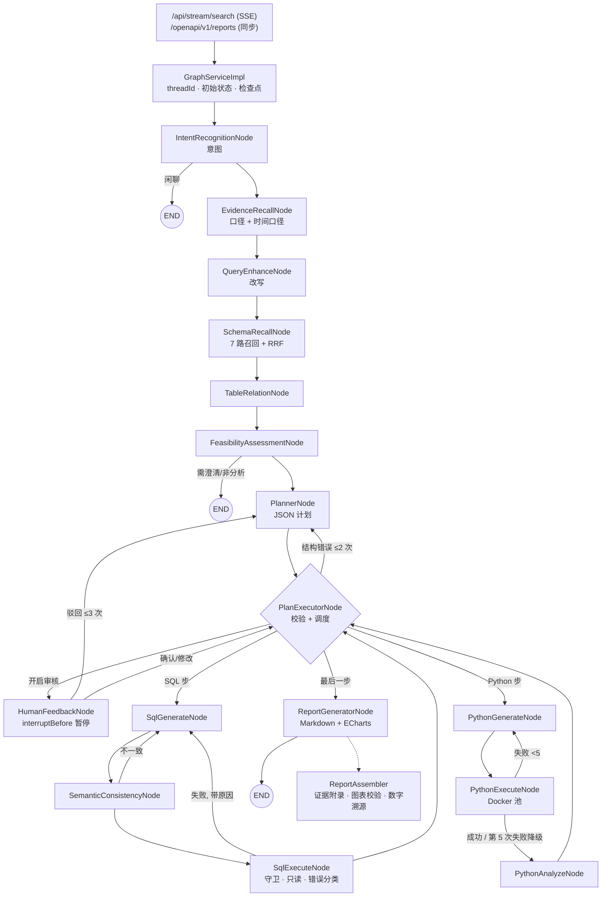

# 00 整体架构一页纸：一次请求从入口到报告

> 背下来的目标：面试官说"讲讲你这个项目"，你能用 2 分钟把这一页讲完，并且每个框都能接着往下钻。
> 路径缩写：`dataagent/` = `gbi-agent/src/main/java/com/alibaba/cloud/ai/dataagent/`

## 0. 业务和数据背景 → 设计推导（先讲这个）

> 原型参照品牌电商服务商（以宝尊电商为例）的**公开**业务模式。下面关于数据来源和形态的描述，是根据公开资料和行业通行做法推断的，不是任何公司的内部资料；仓库里的数据全部是模拟的。面试时的说法："我参照品牌电商代运营公司的公开业务模式，模拟了一套数仓，在上面做问数 agent。"

**业务**：服务商替几十上百个品牌在天猫、京东、抖音等平台运营官方旗舰店（店铺运营、投放、客服、仓配）。合作模式有三种：经销（自己买货再卖，背库存）、代运营（货权在品牌方，按 GMV 收服务费）、品牌管理（持有品牌中国区经营权）。运营每天要回答品牌方"昨天为什么跌了""哪个 SKU 拖了后腿"，分析师写 SQL、出周报是瓶颈。

**数据从哪来（推断）**

| 来源 | 内容 | 时效 |
|---|---|---|
| 平台开放接口 / 云内环境（如聚石塔、京东云鼎） | 订单、退款、商品、库存、评价；各平台字段、状态码、订单号格式都不一样 | 近实时 |
| 平台的经营 / 投放后台（生意参谋、京东商智、巨量千川等） | 流量、投放花费，多是按天汇总的报表 | T+1 |
| 自有系统：OMS / WMS / TMS / ERP / 财务 / 客服 / CRM | 多平台订单汇总拆单、入库出库库存、物流轨迹、采购和经销库存、结算和服务费、工单、会员 | 订单库存近实时，财务按月 |
| 品牌方 | SKU 主数据、价格带、目标、对账口径（Excel 或接口） | 不定期 |

**数据长什么样（推断）**：数仓分层 ODS → DWD → DWS → ADS；各平台原始字段在进 DWD 时统一成标准模型；主键是品牌、平台、店铺、SKU、仓；**品牌是隔离单位**（多租户），权限按品牌、店铺、仓授权。

**这决定了 agent 怎么设计**

| 数据特点 | 设计决定 | 对应讲稿 |
|---|---|---|
| agent 只查数仓（DWD/DWS），不直连平台接口；宽表多、相似表多 | 选表是头号难点 → 多路召回 + Recall@5 评测 | 01 |
| 口径在经销 / 代运营下不同（"收入"、GMV） | 业务术语和指标口径要单独召回，写进证据 | 01、10 |
| 平台原始状态码、编码异构 | 枚举值召回 + 列样例；跨平台统计用统一字段 | 01、10 |
| 品牌是隔离单位 | 数据权限在 SQL 层强制改写 + 表白名单 + 只读账号 | 04、09 |
| 时效不同（订单实时、投放 T+1、结算按月） | 问"今天的投放"要说明还没有数据，不能编 | 10（缺口） |
| 报告给品牌方看，数字要能追溯 | 系统附证据、先算好合计；conversationId 串起计划、SQL、修复 | 06、07 |
| 归因要跨仓储、履约、营销 | 规划 → 多步 SQL → Python → 报告，规划可人工审核 | 02、03、05 |

**模拟数据怎么对应这套分层**（`dataset/README.md` 的 v2 一节）：86 张表相当于 DWD 明细 + 维表（`trd_`/`prd_`/`usr_`/`mkt_`/`scm_`/`wms_`/`tms_`/`oms_`/`fin_`/`dim_`），`trd_daily_shop_sales`、`trd_daily_sku_sales` 相当于 DWS 汇总（T+1）；`trd_order.platform_status`、`platform_order_no` 保留了平台原始值（ODS 痕迹），`order_status` 是统一后的值；`dim_shop.brand_id` 把店铺挂到品牌客户上；投放和流量表 T+1，结算按月。没有单独建 ODS 层和"跨平台 SKU 映射表"，这是简化，被问到要说清楚。

具体到六个难点的例子和真实运行结果，见 [10-baozun-scenario.md](10-baozun-scenario.md)。

## 1. 一句话

复现阿里云百炼"析言 GBI"的企业问数链路：用户问一句业务问题（"3 月华东数码类 GMV 环比为什么跌了"），系统完成 **选表 → 规划 → 写 SQL 并校验 → 执行 → Python 计算 → 带图表和证据的报告**，场景是电商经营 + 库存/仓储/履约（86 张表、1,146 字段、312 条业务术语）。

底座是开源的 spring-ai-alibaba/DataAgent（固定在 commit b297203），**图的骨架和状态字段是借的**，我做的是：数据集与评测集、召回、SQL 守卫、人工审核改造、沙箱修复、报告接口，以及（未合并分支上的）RuoYi 式鉴权与数据权限、Turbo/Mix 和混合部署。

## 2. 2 分钟讲法（照这个顺序讲）

1. **入口**：前端/调用方发 `GET /api/stream/search`（SSE 流）或 `POST /openapi/v1/reports`（同步拿整份报告）。带 `threadId`（就是 conversationId）。
2. **起图**：`GraphServiceImpl.graphStreamProcess` → `handleNewProcess`，把问题、agentId、多轮上下文、各种计数器清零后 `compiledGraph.stream(初始状态, threadId)`。图在启动时 `compile(interruptBefore(HUMAN_FEEDBACK_NODE))`，检查点可以存 MySQL。
3. **理解问题**：意图识别（闲聊直接结束）→ 证据召回（业务术语/口径 + 我加的【时间口径】）→ 问题改写。
4. **选表**：`SchemaRecallNode` 调 `TableRecallService`，7 路召回 + RRF 融合取前 K 张表 → `TableRelationNode` 补外键关系 → 可行性评估（不是数据分析问题或需要澄清就结束）。
5. **规划**：`PlannerNode` 让 LLM 输出 JSON 执行计划（每步用 SQL 还是 Python）→ `PlanExecutorNode` 校验计划结构，开了人工审核就停在 `HumanFeedbackNode` 前，等人确认/修改/驳回，之后按 threadId 恢复。
6. **逐步执行计划**：`PlanExecutorNode` 是"调度器"，按当前步骤分派：
   - SQL 步：`SqlGenerateNode`（Qwen 生成）→ `SemanticConsistencyNode`（LLM 检查是否回答了问题）→ `SqlExecuteNode`（**JSqlParser 守卫** → 只读执行 → 失败按"选表/方言/执行"分类，带原因回到生成，最多 10 次）。
   - Python 步：`PythonGenerateNode` → `PythonExecuteNode`（Docker 容器池，1 核/500MiB/60s/无网络）→ 失败回去重写，5 次后**显式降级** → `PythonAnalyzeNode`。
   - 每步结束回到 `PlanExecutorNode` 取下一步。
7. **出报告**：`ReportGeneratorNode` 写 Markdown（内嵌 ECharts JSON），报告前系统先算好合计（`ResultTotals`）；开放接口再由 `ReportAssembler` 附上**系统生成的证据附录**、校验图表、做数字溯源（`NumberTrace`），返回 `status / issues`。

## 3. 图（节点就是代码里的 16 个 addNode）

## 4. 关键代码位置速查

| 环节 | 文件 / 方法 |
|---|---|
| 图的定义（节点、边、状态字段 KeyStrategy） | `dataagent/config/DataAgentConfiguration.java`（`addNode` / `addConditionalEdges`） |
| 编译、暂停、检查点、恢复 | `dataagent/service/graph/GraphServiceImpl.java`：构造器里 `interruptBefore` + `MysqlSaver`；`handleNewProcess`；`handleHumanFeedback`（`updateState` 后 `stream(null)`） |
| 路由逻辑 | `dataagent/workflow/dispatcher/*Dispatcher.java`（每个条件边一个类） |
| 召回 | `dataagent/service/schema/recall/TableRecallService.java`：`rank()`、`fuse()`（RRF）、`termTables`、`joinTables`、`valueIndex` |
| 时间口径 | `dataagent/service/nl2sql/TimeRangeHints.java`，在 `EvidenceRecallNode` 注入 |
| SQL 守卫 / 错误分类 | `dataagent/service/sql/guard/SqlGuard.check()`、`SqlErrorClassifier.classify()/repairHint()`；在 `SqlExecuteNode.guard()/blocked()` 调用 |
| 人工审核 | `dataagent/workflow/node/HumanFeedbackNode.decide()`、`service/hitl/GbiHitlProperties` |
| 沙箱 | `dataagent/service/code/impls/DockerCodePoolExecutorService.java`：`createHostConfig()`、`execTaskInContainer()`、`currentRunOnly()`；池在 `AbstractCodePoolExecutorService` |
| 降级 | `PythonExecuteNode`（输出 `{"degraded":true,...}`）、`PythonExecutorDispatcher`、`PythonAnalyzeNode` |
| 报告接口 | `dataagent/controller/ReportApiController.java`、`service/report/ReportAssembler / NumberTrace / ResultTotals` |
| 评测 | `eval/table_select`（180 题）、`eval/sql_guard`（75 例）、`eval/nl2sql`（320 题）、`eval/report`（40 任务）、`eval/scripts/run_*.py` |

## 5. 状态怎么流动（被问"节点之间怎么传数据"时用）

- 所有节点共享一个 `OverAllState`（一个 Map），每个 key 在 `DataAgentConfiguration` 里声明合并策略，这里全是 `REPLACE`。
- 节点 `apply(state)` 返回一个 Map，框架按策略合并进状态；Dispatcher 只读状态、返回下一个节点名。
- 检查点就是"每走完一个节点，把整个 state 序列化存一份"，key 是 threadId。所以暂停/恢复/重启后继续都靠它。
- 我新加的状态字段：`HUMAN_REPLAN_COUNT`、`HUMAN_REJECT_REASONS`、`HUMAN_REVIEW_STATUS`（审核）、`PYTHON_FALLBACK_MODE` 的语义（降级），未合并分支里还有 `GBI_DATA_PERMISSION`、`GBI_MODE`。

## 6. 讲的时候要守住的边界

- **不要说图是自己从零搭的。** 说"在开源 DataAgent 的图上，改了召回、守卫、审核、沙箱、报告五处，每处都有前后对比"。
- **数字只讲实测的**，简历上没跑到的要能说出"实测是多少、差在哪、怎么补"。见 [99-gaps.md](99-gaps.md)。
